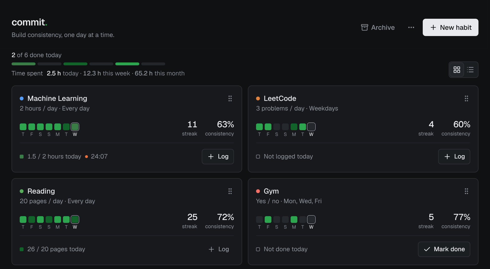
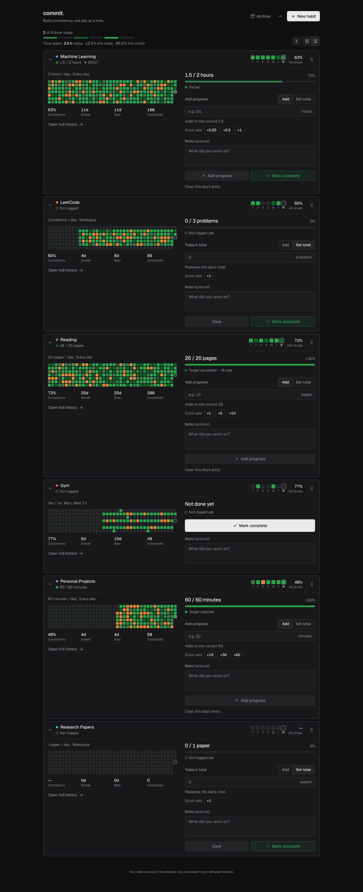
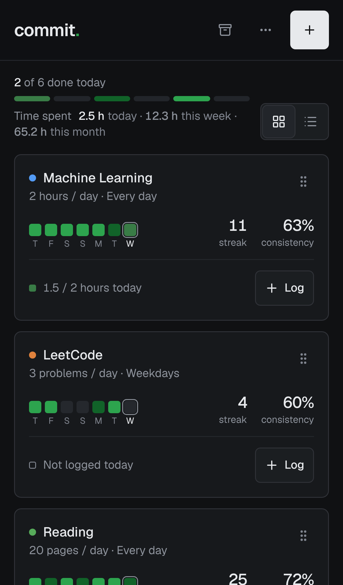

Looking for the full-stack web app (React + FastAPI + Postgres) instead? It's on the <a href="https://github.com/ojhnny/commit./tree/fullstack"><code>fullstack</code> branch</a>.

# commit. for Obsidian

> Build consistency, one day at a time.

A habit tracker for Obsidian where every habit gets its own GitHub-style contribution graph. Log progress in a couple of clicks, then watch your streaks and consistency build up, all inside your vault.

  

- **A contribution graph per habit.** Year, month and calendar views, colored by how each day went.
- **Flexible goals.** Yes/no, or an amount per day (minutes, hours, pages, problems, workouts, or your own unit).
- **Custom schedules.** Every day, weekdays, weekends or specific days. Rest days never count against you.
- **Streaks and consistency.** Current streak, longest streak, completed days and consistency %.
- **Your data stays in your vault.** One JSON file that syncs wherever your vault syncs. No account, no server, no network requests.
- **Desktop and mobile.** Works on macOS, Windows, Linux, iPhone, iPad and Android.

## Screenshots

*The plugin uses the same interface as the commit. web app. These screenshots use the built-in sample data.*

**Dashboard.** Every habit at a glance: the last 7 days, current streak, consistency and today's progress.

**Yearly heatmap.** One square per day, colored by how that day went. Hover over or tap any day for the details.

**List view.** Collapsible rows with the full graph and a quick logger for each habit.

**On your phone.**

  
  &nbsp;
  

## Install

### Option 1: BRAT (easiest, gets updates)

1. In Obsidian, install and enable **BRAT** from **Settings → Community plugins → Browse**.
2. Run **BRAT: Add a beta plugin for testing** from the command palette (Cmd/Ctrl+P).
3. Paste `ojhnny/commit.` and click **Add plugin**.
4. Go to **Settings → Community plugins** and turn on **commit.**

### Option 2: Manual

1. Open the [latest release](https://github.com/ojhnny/commit./releases/latest) and download `commit-habits.zip`. Or download the three files `main.js`, `manifest.json` and `styles.css` from the release.
2. Unzip it. You get a folder named `commit-habits`.
3. Move that folder into your vault at `<your vault>/.obsidian/plugins/commit-habits/`.
   - `.obsidian` is a hidden folder. On macOS press **Cmd+Shift+.** in Finder to show it. On Windows turn on **View → Show → Hidden items**.
   - If there's no `plugins` folder yet, create it.
4. In Obsidian open **Settings → Community plugins**.
   - If **Restricted mode** is on, turn it off.
   - Click the **reload icon** next to "Installed plugins".
   - Turn on **commit.**

**On iPhone or iPad:** copy the same `commit-habits` folder into your vault's `.obsidian/plugins/` folder with the Files app, or let Obsidian Sync or iCloud bring it over from your computer. Then turn it on under **Settings → Community plugins**, the same as on desktop.

## Getting started

1. **Open it.** Click the **calendar-check icon** in the left ribbon, or run **commit.: Open habits** from the command palette. It opens as a normal tab, so you can pin it, split it or drag it into a sidebar.
2. **Look around first (optional).** On a fresh start you can choose **Explore with sample data** to see a few months of example habits and how the graphs look. You can remove them later with **⋯ → Remove sample habits**.
3. **Create a habit.** Click **New habit**, or press **N** while the commit. view is focused.
   - **Name**, for example "Reading", plus an optional description of why it matters or what counts.
   - **Goal type:** *Yes / no* for things you either did or didn't do, or an amount with a **Unit** (minutes, pages, workouts, or a custom unit like "km") and a **Daily target**.
   - **Repeat:** every day, weekdays, weekends or custom days. Unscheduled days are rest days and are skipped in your stats.
   - **Start date:** days before this aren't counted.
4. **Log progress.** Click a habit to log today. Use **Quick add** for common amounts, **Add** to add to today's total or **Set total** to replace it, and add a note about what you worked on. **Undo** reverts the last change.
5. **Read your graph.** Hover over or tap any square to see that day. Switch between **Year**, **Month** and **Calendar view** on a habit's page, and between **Grid view** and **List view** on the dashboard.
6. **Edit or delete** a habit from its page. Changing a goal only applies from today on, so your past days are still judged by the goal you had back then.

### What the colors mean

| Day | Color |
|---|---|
| Hit your target | Green |
| Went past your target | Dark green |
| Some progress, but under target | Muted green |
| Scheduled day that passed with nothing logged | Orange (missed) |
| Today with nothing logged yet | Gray. Never counts as missed until the day is over. |
| Rest day, before the start date, or in the future | Gray, left out of your stats |

**Consistency** is the share of scheduled days you completed. Today only counts once you finish it. **Streaks** count consecutive completed scheduled days. Rest days don't break them, and an unfinished today doesn't either.

## Your data

Everything lives in one file in your vault: **`commit/habits.json`**. You can change the path under **Settings → commit. → Data file**.

- **Sync:** it syncs with whatever syncs your vault (Obsidian Sync, iCloud, Dropbox, git). If the file changes on another device, any open commit. views reload by themselves.
- **Backups:** **Save backup to vault** in the **⋯** menu writes a dated copy to `commit/backups/`. You can change that folder under **Settings → commit. → Backup folder**.
- **Restore:** **Restore from backup…** in the **⋯** menu loads a backup and replaces your current data.

## Commands

| Command | What it does |
|---|---|
| **commit.: Open habits** | Open the habits view |
| **commit.: Open habits in a new tab** | Open it in a separate tab |
| **commit.: Open habits in the right sidebar** | Keep it docked next to your notes |
| **N** (inside the view) | New habit |

## Web app

commit. also exists as a full-stack web app (React, FastAPI and PostgreSQL) with sign-in and sync across browsers. It isn't hosted publicly yet, but you can run it yourself. The code and setup guide are on the [`fullstack` branch](https://github.com/ojhnny/commit./tree/fullstack).

## License

[MIT](./LICENSE)
